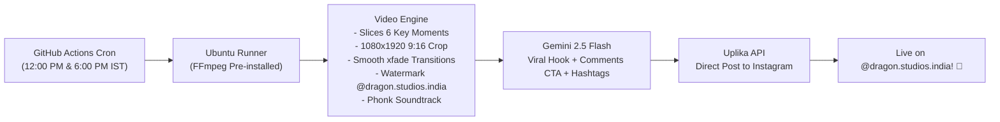

# 🎬 Autonomous Anime Reel Cloud Factory & Auto-Poster

A **100% Free, Zero-Server-Cost Cloud Automation** that automatically generates high-retention anime montage reels with smooth transitions (`xfade`), phonk audio, `@dragon.studios.india` watermark, AI-crafted viral captions (Gemini), and publishes directly to Instagram on a daily schedule.

---

## ⚡ How It Works (100% Free on GitHub Actions)



- **Cost:** **$0.00 / month** (Runs inside GitHub Actions' free 2,000 monthly runner minutes; each reel takes ~40 seconds).
- **No external server required**: No VPS, no AWS bills, no credit card needed.
- **Includes starter clip pack**: Bundled directly in `clips/` so GitHub Actions works out of the box immediately.

---

## 🚀 Quick Setup: Push to Your Free GitHub Repo

### Step 1: Initialize Git & Push to GitHub

In your terminal:

```bash
cd "/home/001268796482_0/Videos/anime_cloud_automation"
git init
git add .
git commit -m "Initial commit: Autonomous Anime Reel Cloud Factory"
git branch -M main

# Create a new repository on https://github.com/new (make it Private)
# Then link and push:
git remote add origin https://github.com/<YOUR_GITHUB_USERNAME>/<YOUR_REPO_NAME>.git
git push -u origin main
```

---

### Step 2: Configure GitHub Repository Secrets

Go to your repository on GitHub:
**Settings** ➔ **Secrets and variables** ➔ **Actions** ➔ **New repository secret**:

| Secret Name | Value | Purpose |
| :--- | :--- | :--- |
| `UPLIKA_API_KEY` | `sk_6e85888ae9c16610bd87c90e34a7290818636b55cde49d2c37f9be2e7717b5d5` | Uplika API authentication |
| `UPLIKA_ACCOUNT_ID` | `conn_8fe3721242166de7` | Target Instagram connection |
| `GEMINI_API_KEY` | *(Your free key from [aistudio.google.com](https://aistudio.google.com/))* | Generates viral captions |

*(Note: Even if `GEMINI_API_KEY` is not provided, the pipeline automatically falls back to built-in high-converting viral templates!)*

---

### Step 3: Trigger or Watch It Run Automatically

1. **Automatic Daily Schedule:**
   - **12:00 PM IST (06:30 UTC)** — Peak lunchtime engagement.
   - **6:00 PM IST (12:30 UTC)** — Peak evening entertainment.
2. **Manual 1-Click Trigger:**
   - Go to the **Actions** tab on your GitHub repository.
   - Click **"Autonomous Anime Reel Publisher"** on the left.
   - Click **"Run workflow"** ➔ Select Theme (or Random) ➔ Click **Run workflow**!
   - In ~45 seconds, the reel will render, get uploaded to Instagram, and the live link will be printed in the log!

---

## 💻 Running Locally (Optional)

You can also run or test the pipeline locally on your machine at any time:

```bash
cd "/home/001268796482_0/Videos/anime_cloud_automation"

# Test render only (dry run - does not publish to Instagram):
python3 pipeline.py --dry-run

# Full render and live upload to Instagram:
python3 pipeline.py
```
